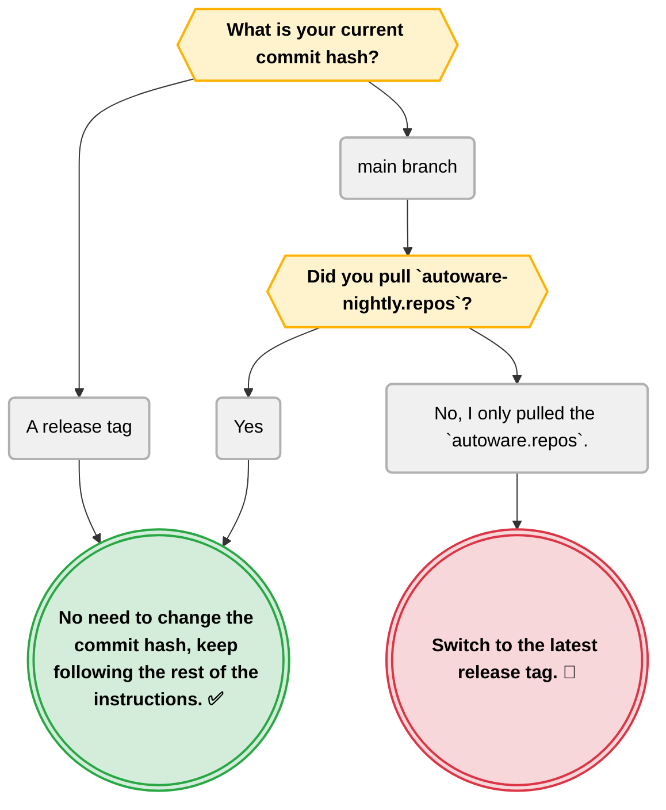

# Autoware artifacts

The Autoware perception stack uses models for inference. These models are downloaded by running `ansible-playbook autoware.dev_env.install_dev_env --tags artifacts`.

Every model is hosted on [Hugging Face](https://huggingface.co/AutowareFoundation), under the `AutowareFoundation` organization. Each download is pinned to a tag.

Default `data_dir` location is `~/autoware_data/ml_models` (part of the asset-typed `~/autoware_data/` layout: `assets/`, `maps/`, `ml_models/`, `recordings/`, `scenarios/`).

## Download instructions

### Check out to the correct commit hash if necessary

First check this chart if you need to change your current commit hash.



If you need to switch to the latest tag, run the following commands:

```bash
cd ~/autoware
git fetch --tags && git checkout $(git describe --tags $(git rev-list --tags --max-count=1))
```

Once you've downloaded the artifacts, you can switch back to your desired branch or commit hash.

### Requirements

Install ansible following the instructions in the [ansible installation guide](../../README.md#ansible-installation).

### Download artifacts

#### Install ansible collections

```bash
cd ~/autoware # The root directory of the cloned repository
ansible-galaxy collection install -f -r "ansible-galaxy-requirements.yaml"
```

This step should be repeated when a new playbook is added.

#### Run the playbook

```bash
ansible-playbook autoware.dev_env.install_dev_env --tags artifacts -e "data_dir=$HOME/autoware_data/ml_models" --ask-become-pass
```

This will download the artifacts to the specified directory. Each model bundle is pinned to a version tag on Hugging Face. Their integrity relies on the Hub and the transport, not on checksums pinned in this role.

Every task in this role downloads as the user that runs the playbook, so the artifacts stay owned by that user. No task in this role uses sudo. Two of its dependencies do, and each one only under a condition:

- `autoware_data_ownership` corrects an install that root owns
- `huggingface_cli` installs pipx when pipx is absent

Keep `--ask-become-pass` while either condition can be true.

### Migrating from the legacy layout

Earlier versions of this role downloaded directly into `~/autoware_data/`. To match the new
layout, move the existing model directories under `~/autoware_data/ml_models/` (and, if you
were using `~/autoware_map/`, into `~/autoware_data/maps/`):

```bash
mkdir -p ~/autoware_data/ml_models
shopt -s extglob
mv ~/autoware_data/!(ml_models|maps|recordings|scenarios|assets) ~/autoware_data/ml_models/

# only if you also have ~/autoware_map/
[ -d ~/autoware_map ] && mv ~/autoware_map ~/autoware_data/maps
```

Re-running the playbook is also safe: it will populate the new `ml_models/` directory and you
can delete the old top-level model folders afterwards.

## Abbreviations, terms and symbols

| Term                                       | Meaning                                                                                                                                |
| ------------------------------------------ | -------------------------------------------------------------------------------------------------------------------------------------- |
| Ansible                                    | An automation tool that sets up a machine by running steps written in YAML files                                                       |
| ansible-galaxy                             | Ansible's command for installing collections and roles that a project depends on                                                       |
| ansible-playbook                           | Ansible's command that runs a playbook on the machine                                                                                  |
| artifacts                                  | Here, the trained machine learning model files that Autoware downloads                                                                 |
| asset-typed                                | Organised into one subfolder per kind of data (assets, maps, models, recordings, scenarios)                                            |
| Autoware                                   | An open-source software stack for self-driving vehicles; this repository sets up its development environment                           |
| `autoware.repos`, `autoware-nightly.repos` | Files listing the source repositories to download into the Autoware workspace; the nightly one follows the latest development versions |
| branch                                     | A line of development in Git; `main` is the main one                                                                                   |
| checksum                                   | A short fingerprint of a file used to detect corruption or tampering                                                                   |
| collection                                 | A bundle of Ansible playbooks and roles distributed together; this repository's collection is `autoware.dev_env`                       |
| commit hash                                | The unique ID of a saved change (commit) in Git                                                                                        |
| `data_dir`                                 | The variable that sets the folder the models are downloaded to                                                                         |
| dependencies                               | Here, other roles that this role runs first                                                                                            |
| `extglob`                                  | A bash option that turns on extended patterns such as `!(a\|b)`                                                                        |
| Git                                        | The version control system used to track changes to source code                                                                        |
| Hub                                        | The Hugging Face Hub, the service that stores the models                                                                               |
| Hugging Face                               | A website that hosts machine learning models and datasets for download                                                                 |
| inference                                  | Running a trained model on new data to get its output, such as detected objects                                                        |
| integrity                                  | That a downloaded file is complete and unchanged                                                                                       |
| legacy                                     | The older, no longer recommended way                                                                                                   |
| mermaid                                    | Mermaid: a text-based diagram language that GitHub draws as a chart                                                                    |
| ML                                         | Machine Learning: software that learns its behaviour from data; here, the trained models Autoware runs                                 |
| model                                      | A trained neural network saved as files                                                                                                |
| perception stack                           | The part of Autoware that interprets sensor data to find objects and the surroundings                                                  |
| pinned                                     | Fixed to one exact version                                                                                                             |
| pipx                                       | A tool that installs Python command-line applications, each in its own isolated environment                                            |
| playbook                                   | An Ansible file that lists which roles and tasks to run; this repository's main one is `install_dev_env`                               |
| release tag                                | A Git tag that marks an official release                                                                                               |
| role                                       | A reusable unit of Ansible tasks that installs or configures one thing; each folder under `ansible/roles/` is a role                   |
| root                                       | The Linux administrator account, which can change any file on the system                                                               |
| `shopt`                                    | A bash command that turns shell options on and off                                                                                     |
| sudo                                       | A command that runs another command with administrator (root) rights, after asking for your password                                   |
| tag                                        | A named label attached to one version, such as a Git commit or a model revision                                                        |
| task                                       | A single step in an Ansible role, such as installing one package                                                                       |
| transport                                  | The network connection used for the download                                                                                           |
| `--tags`                                   | For `ansible-playbook`: run only the roles and tasks carrying the given tag                                                            |
| `~`                                        | Shorthand for your home directory, for example `/home/<you>`                                                                           |
| `{{ }}`, `( )`, `((( )))`                  | Mermaid shapes: a decision, an option and a final outcome                                                                              |
| `-->`                                      | Mermaid arrow from one diagram box to the next                                                                                         |
| ✅                                         | Check mark: no action needed                                                                                                           |
| 🔄                                         | Arrows in a circle: switch to a different version                                                                                      |
| `%%`                                       | Starts a comment in a Mermaid diagram                                                                                                  |
| `#FFF3CD`                                  | A colour written as a hexadecimal code (red, green, blue)                                                                              |
| `&&`                                       | Runs the next command only if the previous one succeeded                                                                               |
| `$(...)`                                   | Command substitution: runs the command inside and puts its output in its place                                                         |
| `#`                                        | In a shell or config block, starts a comment that is not run                                                                           |
| `-f`                                       | For `ansible-galaxy`: reinstall even if already installed (force)                                                                      |
| `-r`                                       | For `ansible-galaxy`: read the list of things to install from the named requirements file                                              |
| `-e`                                       | For `ansible-playbook`: sets a variable for this run, overriding its default (short for `--extra-vars`)                                |
| `$HOME`                                    | The environment variable holding the path of your home directory                                                                       |
| `--ask-become-pass`                        | For `ansible-playbook`: asks for your sudo password once, so steps that need administrator rights can run                              |
| `-p`                                       | For `mkdir`: create the folder and any missing parent folders, with no error if it exists                                              |
| `!(...)`                                   | With `extglob`, matches every name except those listed                                                                                 |
| `[ -d ... ]`                               | A shell test that is true when the folder exists                                                                                       |

Other project terms are defined in the [Glossary](../../../wiki/Glossary.md).
