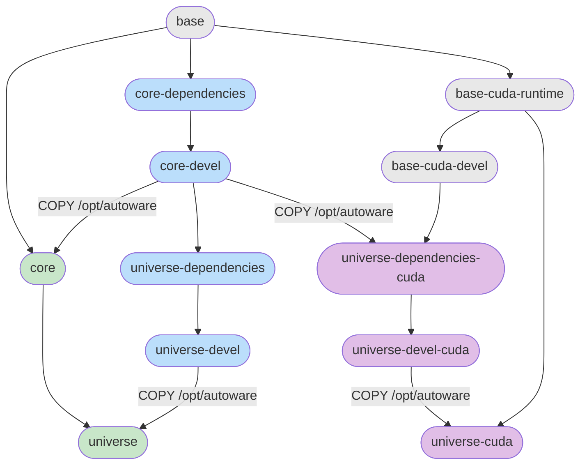

# Run Autoware in Docker

<!-- cspell:ignore libcuda libcudart ctypes CDLL byref prereq tegrastats NVDEC NVENC -->

## Image Graph



## Images

| Image                        | Description                                                                           | Use case                                                   |
| ---------------------------- | ------------------------------------------------------------------------------------- | ---------------------------------------------------------- |
| `base`                       | ROS base, sudo, pipx, ansible, RMW, user `aw`                                         | Foundation for all other images                            |
| `core-dependencies`          | Build deps + compiled core packages (except autoware_core and autoware_rviz_plugins)  | CI for autoware_core                                       |
| `core-devel`                 | Adds autoware_core build on top of core-dependencies                                  | Development and CI for packages depending on autoware_core |
| `core`                       | Runtime-only: rosdep exec deps + compiled core from core-devel                        | Lightweight core runtime                                   |
| `base-cuda-runtime`          | `base` + CUDA/cuDNN/TensorRT runtime libs (no `-dev` packages)                        | Runtime foundation for `universe-cuda`                     |
| `base-cuda-devel`            | `base-cuda-runtime` + CUDA/cuDNN/TensorRT dev headers                                 | Build foundation for CUDA universe packages                |
| `universe-dependencies`      | Acados + rosdep build deps for all of autoware (non-CUDA path)                        | CI for autoware_universe                                   |
| `universe-dependencies-cuda` | Core ansible roles + acados + rosdep build deps, inherits CUDA from `base-cuda-devel` | CI for CUDA-dependent packages                             |
| `universe-devel`             | Builds all universe sources (no CUDA)                                                 | Development without GPU                                    |
| `universe-devel-cuda`        | Builds all universe sources with CUDA                                                 | Development with GPU                                       |
| `universe`                   | Runtime image with compiled autoware (no CUDA)                                        | Deployment without GPU                                     |
| `universe-cuda`              | Runtime image with compiled autoware, inherits CUDA runtime from `base-cuda-runtime`  | Deployment with GPU                                        |

## Pull from GHCR

Pre-built multi-arch images (amd64 + arm64) are available on GHCR:

```bash
# Pull a specific image
docker pull ghcr.io/autowarefoundation/autoware:base-jazzy
docker pull ghcr.io/autowarefoundation/autoware:base-humble

# Pull a dated version (for pinning)
docker pull ghcr.io/autowarefoundation/autoware:base-jazzy-20260407

# Pull a release version
docker pull ghcr.io/autowarefoundation/autoware:base-jazzy-1.2.3
```

Tag pattern: `<stage>-<ros_distro>[-<date>|-<version>]`

Available images (replace `jazzy` with `humble` for other distros):

| Tag                                | Description                                       |
| ---------------------------------- | ------------------------------------------------- |
| `base-jazzy`                       | ROS base + ansible + user aw                      |
| `core-dependencies-jazzy`          | Build deps + core packages (except autoware_core) |
| `core-devel-jazzy`                 | Full core development image                       |
| `core-jazzy`                       | Lightweight core runtime                          |
| `base-cuda-runtime-jazzy`          | base + CUDA/cuDNN/TensorRT runtime                |
| `base-cuda-devel-jazzy`            | base-cuda-runtime + CUDA/cuDNN/TensorRT dev       |
| `universe-dependencies-jazzy`      | Universe build dependencies (no CUDA)             |
| `universe-dependencies-cuda-jazzy` | Universe build deps on base-cuda-devel            |
| `universe-devel-jazzy`             | Full universe development (no CUDA)               |
| `universe-devel-cuda-jazzy`        | Full universe development with CUDA               |
| `universe-jazzy`                   | Runtime without GPU                               |
| `universe-cuda-jazzy`              | Runtime with GPU                                  |

## Build locally

From the repository root. Targets beyond `base` require source repositories under `src/`:

```bash
# Clone source repositories (needed for core and universe targets)
vcs import src < repositories/autoware.repos

# Build all default targets (universe + universe-cuda)
docker buildx bake -f docker/docker-bake.hcl

# Build a specific target (dependencies are resolved automatically)
docker buildx bake -f docker/docker-bake.hcl base
docker buildx bake -f docker/docker-bake.hcl core-devel
docker buildx bake -f docker/docker-bake.hcl universe
docker buildx bake -f docker/docker-bake.hcl universe-cuda

# Build for humble
ROS_DISTRO=humble docker buildx bake -f docker/docker-bake.hcl base
```

## Reproducible builds (`USE_LOCKFILE`)

By default a target builds against the floating `ros:<distro>-ros-base` tag and the latest packages from `packages.ros.org` and the Ubuntu archive, so the same target built on different days can differ. Set `USE_LOCKFILE=true` to make the build reproducible:

```bash
# Reproducible base image for the default distro (jazzy)
USE_LOCKFILE=true docker buildx bake -f docker/docker-bake.hcl base

# Reproducible build for humble
USE_LOCKFILE=true ROS_DISTRO=humble docker buildx bake -f docker/docker-bake.hcl base
```

When enabled, the build:

- pins the base image to the per-distro digest in `BASE_IMAGE_DIGESTS` (`docker/docker-bake.hcl`) instead of the floating `ros:<distro>-ros-base` tag, freezing the OS-level closure;
- passes `use_locked_versions=true` to ansible, which pins Ubuntu-archive packages to the versions in `ansible/vars/locked-versions-<distro>-<arch>.yaml` and points ROS at the dated `snapshots.ros.org` source recorded in that lockfile, freezing every ROS dependency that snapshot serves;
- walks any package the base image preinstalled at a different version than the snapshot back to the snapshot's version (the floating `ros:<distro>-ros-base` tag is usually newer than the lockfile's `ros_snapshot_date`), so every snapshot-served package in the final image is at its snapshot version; and
- verifies after install that every locked package landed at its pinned version, failing the build on any drift.

Only distros that have **both** a lockfile and a `BASE_IMAGE_DIGESTS` entry can be built in locked mode (currently `humble` and `jazzy`); requesting `USE_LOCKFILE=true` for any other `ROS_DISTRO` fails the build rather than silently falling back to a floating base. The CUDA targets (`base-cuda-*`, `universe-cuda`) also build in locked mode: they inherit the frozen apt pins and dated snapshot from the `base` image they build on, and the CUDA / cuDNN / TensorRT closure from NVIDIA's apt repositories is frozen by the lockfile's `nvidia_pins` section. NVIDIA publishes no dated snapshot, so that closure is pinned by exact version per package (see the version_lock README for how `nvidia_pins` is recorded).

Locked mode is not a hermetic build. The rolling `packages.ros.org` source stays configured, so a `ros-*` package the dated snapshot does not carry — Autoware's own released packages among them — still installs from rolling and floats. See "What the freeze does not cover" in [`ansible/roles/version_lock/README.md`](../ansible/roles/version_lock/README.md), which also documents the lockfile format and how to generate or update lockfiles.

## Usage

```bash
xhost +local:docker

docker run --rm -it \
  --net host \
  --privileged \
  --gpus all \
  -e DISPLAY=$DISPLAY \
  -e NVIDIA_DRIVER_CAPABILITIES=all \
  -e NVIDIA_VISIBLE_DEVICES=all \
  -e HOST_UID=$(id -u) \
  -e HOST_GID=$(id -g) \
  -e QT_X11_NO_MITSHM=1 \
  -v /tmp/.X11-unix:/tmp/.X11-unix:rw \
  -v $HOME/autoware_data/maps:/home/aw/autoware_data/maps \
  -v $HOME/autoware_data/ml_models:/home/aw/autoware_data/ml_models \
  -v $HOME/autoware:/home/aw/autoware \
  -w /home/aw/autoware \
  --runtime=nvidia \
  autoware:universe-cuda-jazzy \
  bash -c "source /opt/autoware/setup.bash && exec bash"
```

| Flag                                | Why                                                                                                  |
| ----------------------------------- | ---------------------------------------------------------------------------------------------------- |
| `--rm`                              | Remove container on exit to avoid accumulating stopped containers                                    |
| `-it`                               | Interactive terminal (stdin + TTY)                                                                   |
| `--net host`                        | Share host network stack so ROS 2 nodes can discover each other                                      |
| `--privileged`                      | Access to host devices (sensors, CAN bus, etc.)                                                      |
| `--gpus all`                        | Expose all GPUs to the container                                                                     |
| `-e DISPLAY`                        | Forward X11 display for GUI applications (rviz2, rqt)                                                |
| `-e NVIDIA_DRIVER_CAPABILITIES=all` | Enable all NVIDIA driver features (compute, graphics, video)                                         |
| `-e NVIDIA_VISIBLE_DEVICES=all`     | Make all GPUs visible inside the container                                                           |
| `-e HOST_UID/HOST_GID`              | Entrypoint remaps the `aw` user to match host UID/GID, avoiding permission issues on mounted volumes |
| `-e QT_X11_NO_MITSHM`               | Disable MIT-SHM for Qt apps (shared memory doesn't work across container boundary)                   |
| `-v /tmp/.X11-unix`                 | Mount X11 socket for GUI forwarding                                                                  |
| `-v autoware_data/maps`             | Mount maps from host (lanelet2 + pointcloud)                                                         |
| `-v autoware_data/ml_models`        | Mount ML model artifacts from host                                                                   |
| `-v autoware`                       | Mount source code for development                                                                    |
| `-w /home/aw/autoware`              | Set working directory to the mounted source                                                          |
| `--runtime=nvidia`                  | Use NVIDIA container runtime for GPU support                                                         |

Or run without volume mounting:

```bash
docker run --rm -it \
  --net host \
  autoware:core-jazzy
```

The default CycloneDDS config uses the `lo` interface (localhost only). To override it, mount your own config:

```bash
docker run --rm -it \
  --net host \
  -v /path/to/your/cyclonedds.xml:/home/aw/cyclonedds.xml \
  autoware:universe-cuda-jazzy
```

### Running on NVIDIA Thor (Jetson Thor / DRIVE Thor)

Under JetPack 7's "unified CUDA 13.0 across all Arm targets" the `universe-cuda-jazzy` image built for `linux/arm64` (SBSA flavor) is the supported runtime on **both Thor variants** — Jetson Thor running JetPack 7 and DRIVE Thor running DRIVE OS share the same Blackwell SoC (`sm_110`) and the same SBSA-compatible CUDA / TensorRT package set.

> The fixes and runtime steps below have been verified end-to-end on a local Jetson Thor (L4T R38.4.0 / CUDA 13.0). DRIVE Thor is expected to work by design — the in-container CUDA stack is identical — but its host-side container-toolkit packaging comes via DRIVE OS rather than the JetPack BSP, so the prereq command names below may differ on a DRIVE host.

Prerequisites on the Thor host:

- An Arm host with Ubuntu 24.04 + Linux 6.8 (Jetson Thor on JetPack 7, or a DRIVE Thor target running DRIVE OS).
- `nvidia-container-toolkit` from the JetPack BSP (or the DRIVE OS equivalent):

  ```bash
  sudo apt-get install -y nvidia-container-toolkit
  sudo nvidia-ctk runtime configure --runtime=docker
  sudo systemctl restart docker
  ```

Launching the image:

```bash
docker run --rm -it \
  --net host \
  --runtime nvidia \
  -e NVIDIA_VISIBLE_DEVICES=all \
  -e NVIDIA_DRIVER_CAPABILITIES=all \
  -e HOST_UID=$(id -u) -e HOST_GID=$(id -g) \
  -v $HOME/autoware_data/maps:/home/aw/autoware_data/maps \
  -v $HOME/autoware_data/ml_models:/home/aw/autoware_data/ml_models \
  autoware:universe-cuda-jazzy \
  bash -c "source /opt/autoware/setup.bash && exec bash"
```

Notes:

- `--gpus all` is **not** used on Tegra; `--runtime nvidia` plus the two `NVIDIA_*` env vars is the supported path. The env vars are what trigger the L4T container toolkit to mount `libcuda.so.1` and `/dev/nvidia-*` into the container — without them `libcuda.so` is absent and CUDA calls fail with `cudaErrorInsufficientDriver` (35).
- `--privileged` is omitted relative to the generic Usage example above; the Thor inference workload here does not touch sensors or CAN bus. Re-add it if you wire in external hardware that needs host device access.
- Inside the container, verify the GPU is reachable:

  ```bash
  python3 -c '
  import ctypes
  rt = ctypes.CDLL("libcudart.so")
  cnt = ctypes.c_int(); rt.cudaGetDeviceCount(ctypes.byref(cnt))
  maj = ctypes.c_int(); minor = ctypes.c_int()
  rt.cudaDeviceGetAttribute(ctypes.byref(maj), 75, 0)
  rt.cudaDeviceGetAttribute(ctypes.byref(minor), 76, 0)
  print(f"devices={cnt.value}, sm_{maj.value}{minor.value}")
  '
  ```

  On Thor this prints `devices=1, sm_110` (rather than a PTX JIT fallback or an `Insufficient driver` error).

- On the host, `sudo tegrastats` while inference runs shows iGPU utilization (`GR3D_FREQ`) climbing above idle.

DLA, VPI, NVDEC/NVENC, and Argus camera support are intentionally out of scope for this image; they require a separate L4T-derived variant.

## Abbreviations, terms and symbols

| Term                          | Meaning                                                                                                                                              |
| ----------------------------- | ---------------------------------------------------------------------------------------------------------------------------------------------------- |
| acados                        | Open-source library for fast optimal control (model predictive control), built into the universe images for Autoware packages that use it            |
| amd64                         | 64-bit x86 processor architecture used by most desktop and server PCs (Intel, AMD)                                                                   |
| ansible                       | Automation tool that installs and configures software from scripts called roles and playbooks; this repository uses it to set up machines and images |
| `apt`                         | Ubuntu's package manager, which installs software packages from online archives                                                                      |
| Argus                         | NVIDIA's camera software interface on Jetson and DRIVE computers                                                                                     |
| Arm                           | A family of processor designs, used in phones and in NVIDIA Jetson and DRIVE computers                                                               |
| arm64                         | 64-bit Arm processor architecture, used by NVIDIA Jetson and DRIVE computers and some servers                                                        |
| Autoware                      | The open-source self-driving software stack that these images package                                                                                |
| `aw`                          | The ordinary (non-administrator) user account that runs Autoware inside the container                                                                |
| Blackwell                     | NVIDIA's GPU architecture generation used in the Thor chip                                                                                           |
| BSP                           | Board support package: the vendor's operating system, drivers and tools for a specific computer board                                                |
| `buildx bake`                 | Docker command that builds several images at once from a definition file (`docker/docker-bake.hcl`)                                                  |
| CAN bus                       | Controller area network: the wired network a vehicle's control units and some sensors use to talk to each other                                      |
| CI                            | Continuous integration: automatic builds and tests that run on every change                                                                          |
| closure                       | The full set of packages installed, including the dependencies of dependencies                                                                       |
| container                     | A running, isolated instance of an image; it shares the host's operating system kernel but has its own files and processes                           |
| core                          | Autoware Core: the small, stable set of essential Autoware packages, and the images that contain them                                                |
| CUDA                          | Compute Unified Device Architecture: NVIDIA's platform for running general computations, such as neural networks, on the GPU                         |
| `cudaErrorInsufficientDriver` | CUDA error (code 35) meaning the GPU driver is missing or too old for the CUDA version                                                               |
| cuDNN                         | CUDA Deep Neural Network library: NVIDIA's GPU library of neural-network building blocks                                                             |
| CycloneDDS                    | Eclipse Cyclone DDS: the DDS implementation Autoware uses to carry ROS 2 messages                                                                    |
| DDS                           | Data Distribution Service: the publish-subscribe networking standard ROS 2 uses to pass messages between nodes                                       |
| deps                          | Dependencies: other software a package needs in order to build or run                                                                                |
| devel                         | Development image: includes compilers, headers and build tools so you can build code, which makes it larger than a runtime image                     |
| `-dev` packages               | Packages with the header files and libraries needed to compile against a library, not just run it                                                    |
| digest                        | A hash (`sha256:...`) that identifies one exact image content, unlike a tag, which can be moved                                                      |
| `DISPLAY`                     | Environment variable that tells GUI programs which X11 screen to draw on                                                                             |
| distro                        | ROS distribution: a named ROS 2 release, such as humble or jazzy                                                                                     |
| DLA                           | Deep Learning Accelerator: a dedicated neural-network chip block on some NVIDIA Jetson and DRIVE computers                                           |
| Docker                        | Software that builds images and runs them as isolated containers                                                                                     |
| drift                         | A package that ended up at a different version than the one pinned in the lockfile                                                                   |
| DRIVE OS                      | NVIDIA's operating system and software stack for its DRIVE automotive computers                                                                      |
| DRIVE Thor                    | NVIDIA's automotive computer built on the Thor chip                                                                                                  |
| entrypoint                    | The script that runs first every time the container starts; here it sets up the `aw` user and the ROS environment                                    |
| env var                       | Environment variable: a named setting passed to programs, set with `-e NAME=value` in `docker run`                                                   |
| exec deps                     | Execution dependencies: what a package needs at run time, as opposed to build time                                                                   |
| floating tag                  | A tag that is moved to newer image content over time, so pulling it on different days can give different images                                      |
| GHCR                          | GitHub Container Registry (`ghcr.io`): GitHub's service for storing and downloading images                                                           |
| GID                           | Group ID: the number Linux uses to identify a user group, which decides file permissions                                                             |
| GPU                           | Graphics processing unit: the graphics card, which Autoware also uses for neural-network perception                                                  |
| `GR3D_FREQ`                   | The `tegrastats` field that shows how busy the GPU is                                                                                                |
| GUI                           | Graphical user interface: a program with windows rather than only text                                                                               |
| hermetic build                | A build whose every input is fixed in advance, so nothing changes with the network or the date                                                       |
| host                          | The physical computer that runs Docker and the containers                                                                                            |
| humble                        | ROS 2 Humble Hawksbill: the 2022 long-term-support ROS 2 release, for Ubuntu 22.04                                                                   |
| iGPU                          | Integrated GPU: a GPU built into the same chip as the processor, as on Jetson and DRIVE                                                              |
| image                         | A packaged, read-only snapshot of an operating system plus installed software, from which containers are started                                     |
| inference                     | Running a trained neural network on new data, for example to detect objects                                                                          |
| jazzy                         | ROS 2 Jazzy Jalisco: the 2024 long-term-support ROS 2 release, for Ubuntu 24.04                                                                      |
| JetPack                       | NVIDIA's software bundle for Jetson computers: Linux, drivers, CUDA and libraries                                                                    |
| Jetson Thor                   | NVIDIA's robotics computer built on the Thor chip                                                                                                    |
| JIT                           | Just-in-time: compiled at the moment it is first run rather than in advance                                                                          |
| L4T                           | Linux for Tegra: NVIDIA's Linux operating system for Jetson computers, part of JetPack                                                               |
| lanelet2                      | The map format Autoware uses for lanes, traffic rules and road layout                                                                                |
| `libcuda.so`                  | The CUDA driver library, provided by the host's NVIDIA driver; CUDA programs cannot use the GPU without it                                           |
| `lo`                          | The loopback network interface: traffic stays on the same computer                                                                                   |
| lockfile                      | A file that records the exact version of every package to install, so builds can be repeated                                                         |
| MIT-SHM                       | An X11 extension that shares memory between a program and the display server, which does not work across the container boundary                      |
| ML                            | Machine learning: here the trained neural-network models Autoware uses for perception                                                                |
| multi-arch                    | One image name that provides builds for several processor architectures, with Docker picking the right one                                           |
| node                          | A single ROS 2 program that sends and receives messages                                                                                              |
| NVDEC                         | NVIDIA's hardware video decoder                                                                                                                      |
| NVENC                         | NVIDIA's hardware video encoder                                                                                                                      |
| NVIDIA                        | Company that makes GPUs and the CUDA software, and the Jetson and DRIVE computers                                                                    |
| NVIDIA Container Toolkit      | NVIDIA software (`nvidia-container-toolkit`) that lets Docker containers use the host's NVIDIA GPU                                                   |
| `nvidia-ctk`                  | The command-line tool of the NVIDIA Container Toolkit, used to configure Docker for the GPU                                                          |
| pin                           | To fix a dependency to one exact version, so it cannot change between builds                                                                         |
| `pipx`                        | Tool that installs Python command-line programs, each in its own isolated environment                                                                |
| pointcloud                    | A map made of 3D points, usually recorded with lidar; see point cloud                                                                                |
| prereq                        | Prerequisite: something that must be in place first                                                                                                  |
| PTX                           | Parallel Thread Execution: NVIDIA's intermediate GPU code, compiled just in time when no ready-made code exists for the GPU                          |
| Qt                            | The GUI toolkit that `rviz2` and `rqt` are built with                                                                                                |
| RMW                           | ROS middleware: the layer in ROS 2 that selects which DDS implementation carries the messages                                                        |
| rolling                       | Here, the continuously updated `packages.ros.org` package source, as opposed to a dated snapshot                                                     |
| ROS 2                         | Robot Operating System 2: the open-source framework Autoware is built on, which passes messages between programs called nodes                        |
| `rosdep`                      | ROS tool that installs the system packages each ROS package declares it needs                                                                        |
| `rqt`                         | A set of ROS graphical tools for inspecting nodes, topics and messages                                                                               |
| runtime                       | Runtime image: contains only what is needed to run the software, so it is smaller than a devel image                                                 |
| `rviz2`                       | RViz: the ROS 2 3D visualisation tool that shows the map, vehicle, sensor data and plans                                                             |
| SBSA                          | Server Base System Architecture: an Arm standard; NVIDIA's CUDA packages for standard arm64 servers, which Thor now also uses                        |
| `sm_110`                      | The GPU generation code (compute capability 11.0) of the Thor GPU; CUDA code must be built for it to run natively                                    |
| snapshot                      | A dated, frozen copy of the ROS package archive (`snapshots.ros.org`), so packages do not change over time                                           |
| SoC                           | System on chip: processor, GPU and other parts on a single chip                                                                                      |
| stage                         | One image in the image graph; each is built on the one before it                                                                                     |
| stdin                         | Standard input: the keyboard input a program reads                                                                                                   |
| `sudo`                        | Linux command that runs another command as the administrator (root)                                                                                  |
| tag                           | The name after the colon in an image name (for example `universe-jazzy`) that selects one variant or version                                         |
| Tegra                         | NVIDIA's family of chips that combine an Arm processor and a GPU, used in Jetson and DRIVE computers                                                 |
| `tegrastats`                  | NVIDIA tool on Jetson and DRIVE computers that prints processor, GPU and memory use                                                                  |
| TensorRT                      | NVIDIA's library that optimises and runs neural networks fast on the GPU                                                                             |
| Thor                          | NVIDIA's computer chip for robots and vehicles, sold as Jetson Thor and DRIVE Thor                                                                   |
| TTY                           | A text terminal, so the program can be used interactively                                                                                            |
| Ubuntu                        | The Linux distribution the images are based on                                                                                                       |
| UID                           | User ID: the number Linux uses to identify a user, which decides who owns files                                                                      |
| universe                      | Autoware Universe: the larger set of Autoware packages beyond Core, and the images that contain them                                                 |
| `vcs`                         | vcstool: a command that clones all the source repositories listed in a `.repos` file                                                                 |
| volume                        | Storage attached to a container, either a mounted host folder or a Docker-managed named volume                                                       |
| VPI                           | Vision Programming Interface: NVIDIA's library for computer-vision processing on its accelerators                                                    |
| X11                           | The X Window System: the Linux display system that draws GUI windows; containers send their windows to the host's X server                           |
| `xhost`                       | Command that controls which programs may open windows on the host's X11 display                                                                      |
| Grey box (image graph)        | A base image                                                                                                                                         |
| Blue box (image graph)        | A development (devel) image                                                                                                                          |
| Green box (image graph)       | A runtime image                                                                                                                                      |
| Purple box (image graph)      | An image with CUDA GPU support                                                                                                                       |
| `+`                           | Plus: the image contains everything in the first item and adds the second                                                                            |
| `#`                           | In shell commands: starts a comment, which is not run                                                                                                |
| `<...>`                       | A placeholder: replace it with your own value, for example `<ros_distro>` with `jazzy`                                                               |
| `[-<date>\|-<version>]`       | An optional part of the tag: either a date or a version, or nothing                                                                                  |
| `\`                           | At the end of a command line: the command continues on the next line                                                                                 |
| `$`                           | In shell commands: reads an environment variable, for example `$DISPLAY`                                                                             |
| `$(...)`                      | In shell commands: run the command inside and use its output, for example `$(id -u)` gives your user ID                                              |
| `&&`                          | In shell commands: run the next command only if the previous one succeeded                                                                           |
| `>` quote block               | A note set apart from the main text                                                                                                                  |

Other project terms are defined in the [Glossary](../wiki/Glossary.md).
