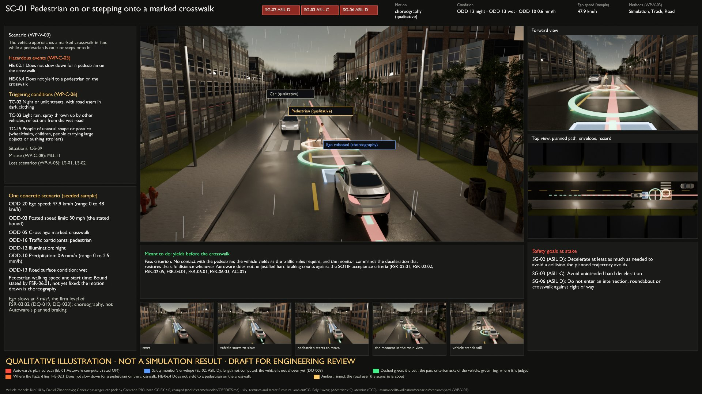

# Scenario scene dashboards

> [!WARNING]
> **Qualitative illustration · not a simulation result · draft for engineering review.** Pictures for understanding and review only: no simulation has been run, nothing here is verification or validation evidence, and no scenario has been run (WP-V-03 §4).

One review dashboard per scene of [`../scenes/`](../scenes/), rendered in Blender by [`../build_blend.py`](../build_blend.py) and explained in [`../README.md`](../README.md). This page is generated by [`../scene.py`](../scene.py); the Render column says whether each committed dashboard was made from the current description of its scene (the manifest beside it records the description's SHA-256, the picture's, and what was built). Re-render a stale one with `build_blend.py tools/sim/scenes/<id>.json --out tools/sim/dashboards --verify`, then run `scene.py`.

| Dashboard | Scenario | Safety goals at stake | Events and triggering conditions | Condition (sample) | Render |
|---|---|---|---|---|---|
| [SC-01](SC-01.jpg) | Pedestrian on or stepping onto a marked crosswalk | SG-02 (D), SG-03 (C), SG-06 (D) | HE-02.1, HE-06.4, TC-02, TC-03, TC-15 | ODD-12 night · ODD-13 wet · ODD-10 0.6 mm/h | current; Blender 5.2.3 LTS, CC0 assets |
| [SC-01--day](SC-01--day.jpg) | Pedestrian on or stepping onto a marked crosswalk | SG-02 (D), SG-03 (C), SG-06 (D) | HE-02.1, HE-06.4, TC-02, TC-03, TC-15 | ODD-12 day · ODD-13 wet · ODD-10 0.6 mm/h (condition variant) | current; Blender 5.2.3 LTS, CC0 assets |
| [SC-02](SC-02.jpg) | Pedestrian emerging from behind a parked vehicle | SG-02 (D), SG-04 (D), SG-06 (D) | HE-04.3, TC-10, TC-17 | ODD-12 day | current; Blender 5.2.3 LTS, CC0 assets |
| [SC-02--night](SC-02--night.jpg) | Pedestrian emerging from behind a parked vehicle | SG-02 (D), SG-04 (D), SG-06 (D) | HE-04.3, TC-10, TC-17 | ODD-12 night (condition variant) | current; Blender 5.2.3 LTS, CC0 assets |
| [SC-03](SC-03.jpg) | Vehicle ahead braking or stopping in congested traffic | SG-01 (D), SG-02 (D), SG-04 (D), SG-06 (D) | HE-01.2, HE-02.2, TC-11, TC-25 | ODD-13 wet · ODD-10 1.5 mm/h | current; Blender 5.2.3 LTS, CC0 assets |
| [SC-04](SC-04.jpg) | Spurious obstacle with a road user following | SG-02 (D), SG-03 (C) | HE-03.1, HE-03.2, TC-03, TC-04, TC-24 | ODD-13 wet · ODD-10 0.5 mm/h · ODD-11 200 m | current; Blender 5.2.3 LTS, CC0 assets |
| [SC-05](SC-05.jpg) | Signalised intersection with cross traffic | SG-02 (D), SG-06 (D) | HE-06.1, TC-01, TC-06, TC-07, TC-19 | ODD-12 day | current; Blender 5.2.3 LTS, CC0 assets |
| [SC-05--night](SC-05--night.jpg) | Signalised intersection with cross traffic | SG-02 (D), SG-06 (D) | HE-06.1, TC-01, TC-06, TC-07, TC-19 | ODD-12 night (condition variant) | current; Blender 5.2.3 LTS, CC0 assets |
| [SC-05--low-sun](SC-05--low-sun.jpg) | Signalised intersection with cross traffic | SG-02 (D), SG-06 (D) | HE-06.1, TC-01, TC-06, TC-07, TC-19 | ODD-12 low-sun (condition variant) | current; Blender 5.2.3 LTS, CC0 assets |
| [SC-06](SC-06.jpg) | Unprotected left turn across oncoming traffic | SG-02 (D), SG-06 (D) | HE-06.2, TC-12, TC-20 | ODD-12 dusk | current; Blender 5.2.3 LTS, CC0 assets |
| [SC-06--night](SC-06--night.jpg) | Unprotected left turn across oncoming traffic | SG-02 (D), SG-06 (D) | HE-06.2, TC-12, TC-20 | ODD-12 night (condition variant) | current; Blender 5.2.3 LTS, CC0 assets |
| [SC-07](SC-07.jpg) | Entry to a roundabout with traffic circulating | SG-02 (D), SG-06 (D) | HE-06.3, TC-13 | not set by the scenario | current; Blender 5.2.3 LTS, CC0 assets |
| [SC-08](SC-08.jpg) | Cyclist alongside on the inside of a turn | SG-02 (D), SG-04 (D), SG-06 (D) | HE-04.2, TC-18 | not set by the scenario | current; Blender 5.2.3 LTS, CC0 assets |
| [SC-09](SC-09.jpg) | Lane keeping where localisation is degraded | SG-02 (D), SG-04 (D), SG-06 (D) | HE-04.1, HE-04.3, TC-08, TC-11 | not set by the scenario | current; Blender 5.2.3 LTS, CC0 assets |
| [SC-09--markings-visible](SC-09--markings-visible.jpg) | Lane keeping where localisation is degraded | SG-02 (D), SG-04 (D), SG-06 (D) | HE-04.1, HE-04.3, TC-08, TC-11 | not set by the scenario (condition variant) | current; Blender 5.2.3 LTS, CC0 assets |
| [SC-10](SC-10.jpg) | Work zone or re-marked lanes not yet in the map | SG-04 (D), SG-06 (D) | TC-09 | ODD-12 day | current; Blender 5.2.3 LTS, CC0 assets |
| [SC-10--night](SC-10--night.jpg) | Work zone or re-marked lanes not yet in the map | SG-04 (D), SG-06 (D) | TC-09 | ODD-12 night (condition variant) | current; Blender 5.2.3 LTS, CC0 assets |
| [SC-11](SC-11.jpg) | Person directing traffic | SG-06 (D) | TC-22 | ODD-12 day | current; Blender 5.2.3 LTS, CC0 assets |
| [SC-11--night](SC-11--night.jpg) | Person directing traffic | SG-06 (D) | TC-22 | ODD-12 night (condition variant) | current; Blender 5.2.3 LTS, CC0 assets |
| [SC-12](SC-12.jpg) | Emergency vehicle approaching with siren and lights | SG-06 (D) | TC-21 | not set by the scenario | current; Blender 5.2.3 LTS, CC0 assets |
| [SC-13](SC-13.jpg) | Rare object or debris in the lane | SG-02 (D), SG-03 (C) | TC-15, TC-16 | ODD-12 day · ODD-13 dry | current; Blender 5.2.3 LTS, CC0 assets |
| [SC-13--night](SC-13--night.jpg) | Rare object or debris in the lane | SG-02 (D), SG-03 (C) | TC-15, TC-16 | ODD-12 night · ODD-13 dry (condition variant) | current; Blender 5.2.3 LTS, CC0 assets |
| [SC-13--unlit](SC-13--unlit.jpg) | Rare object or debris in the lane | SG-02 (D), SG-03 (C) | TC-15, TC-16 | ODD-12 unlit · ODD-13 dry (condition variant) | current; Blender 5.2.3 LTS, CC0 assets |
| [SC-14](SC-14.jpg) | Weather changing toward the ODD limits during a trip | SG-02 (D), SG-03 (C), SG-06 (D), SG-07 (D) | TC-05, TC-28 | ODD-12 dusk · ODD-13 wet · ODD-10 across the limit · ODD-11 across the limit | current; Blender 5.2.3 LTS, CC0 assets |
| [SC-14--night](SC-14--night.jpg) | Weather changing toward the ODD limits during a trip | SG-02 (D), SG-03 (C), SG-06 (D), SG-07 (D) | TC-05, TC-28 | ODD-12 night · ODD-13 wet · ODD-10 across the limit · ODD-11 across the limit (condition variant) | current; Blender 5.2.3 LTS, CC0 assets |
| [SC-15](SC-15.jpg) | Kerbside stop while passengers board or alight | SG-05 (D) | HE-05.1, HE-10.1 | not set by the scenario | current; Blender 5.2.3 LTS, CC0 assets |
| [SC-16](SC-16.jpg) | Stopped at a red light with pedestrians crossing in front | SG-01 (D), SG-05 (D) | HE-01.1, HE-05.2 | ODD-13 dry | current; Blender 5.2.3 LTS, CC0 assets |
| [SC-17](SC-17.jpg) | Loss of Autoware while driving | SG-07 (D) | HE-07.1 | ODD-12 day | current; Blender 5.2.3 LTS, CC0 assets |
| [SC-17--night](SC-17--night.jpg) | Loss of Autoware while driving | SG-07 (D) | HE-07.1 | ODD-12 night (condition variant) | current; Blender 5.2.3 LTS, CC0 assets |
| [SC-18](SC-18.jpg) | Pull-over minimal risk manoeuvre along a busy kerb | — | TC-14 | not set by the scenario | current; Blender 5.2.3 LTS, CC0 assets |
| [SC-19](SC-19.jpg) | Passengers leaving at a stop in lane | SG-07 (D) | TC-29 | ODD-12 day | current; Blender 5.2.3 LTS, CC0 assets |
| [SC-19--night](SC-19--night.jpg) | Passengers leaving at a stop in lane | SG-07 (D) | TC-29 | ODD-12 night (condition variant) | current; Blender 5.2.3 LTS, CC0 assets |
| [SC-22](SC-22.jpg) | Turn indicator during a turn or lane change | SG-09 (C) | HE-09.1 | not set by the scenario | current; Blender 5.2.3 LTS, CC0 assets |
| [SC-23](SC-23.jpg) | Give and take with other drivers | SG-03 (C) | TC-23 | not set by the scenario | current; Blender 5.2.3 LTS, CC0 assets |
