Terms and identifiers as this project uses them. Definitions are plain-language summaries; where a standard defines
a term, the standard governs.

## Identifiers

Identifiers are never reused; a withdrawn item keeps its identifier and is marked `Withdrawn`. The full table is in
[`assurance/README.md`](../assurance/README.md#identifiers).

| Prefix | Meaning |
|---|---|
| `WP-<area>-<nn>` | Work product. Areas: M management, C concept, S system, H hardware, W software, V validation, P supporting processes, A analyses, O production and operation, K safety case, T traceability |
| `DQ-<nnn>` | A question in the [decision register](../assurance/01-management/decisions/README.md). "DQ-015 B" means option B of DQ-015 |
| `G0` to `G6` | Gates, from governance to operation ([WP-M-00 §2](../assurance/01-management/WP-M-00-work-product-register.md#2-gates)) |
| `H-<nn>`, `HE-<nn>.<n>`, `SG-<nn>` | Hazard, hazardous event, safety goal ([WP-C-03](../assurance/02-concept/WP-C-03-hara.md)) |
| `FSR-<nn>.<nn>`, `TSR-<nnn>` | Functional safety requirement, technical safety requirement |
| `SWSR-<nnn>`, `HWSR-<nnn>` | Software and hardware safety requirement |
| `SH-`, `FI-`, `TC-`, `FM-<nn>` | SOTIF hazard, functional insufficiency, triggering condition, functional modification |
| `MRM-<nn>`, `MRC-<nn>` | Minimal risk manoeuvre, minimal risk condition |
| `TS-`, `CSG-`, `CSR-<nn>` | Threat scenario, cybersecurity goal, cybersecurity requirement |
| `AOU-<nn>` | Assumption on the vehicle, infrastructure, people or environment |
| `SPI-<nn>` | Safety performance indicator |
| `CL-`, `EV-`, `DF-<nnn>` | Safety case claim, evidence item, defeater |
| `OI-<n>` | Open item, numbered per document |
| `F-<nn>`, `I-<nn>` | Function and interface of the item ([WP-C-01](../assurance/02-concept/WP-C-01-item-definition.md)) |
| `ODD-<nn>`, `MON-<nn>` | ODD attribute and ODD monitoring function ([WP-C-02](../assurance/02-concept/WP-C-02-odd-and-intended-functionality.md)) |
| `EL-<nn>` | Element of the functional safety concept ([WP-C-04](../assurance/02-concept/WP-C-04-functional-safety-concept.md)) |

## Terms

| Term | Meaning here |
|---|---|
| ASIL | Automotive Safety Integrity Level, A (lowest) to D (highest), set by ISO 26262 for each safety goal from severity, exposure and controllability. QM means no ASIL: ordinary quality management is enough |
| Assessor | An independent person or body who assesses the work (I3). Not yet named: DQ-004 was deferred and is asked again as DQ-007 |
| C, E, S | Controllability, exposure and severity classes used to rate a hazardous event ([WP-C-03 §3.2](../assurance/02-concept/WP-C-03-hara.md#32-ratings)) |
| Confirmation review | A review by someone independent of the author that a key work product, such as the HARA, is right ([WP-M-06](../assurance/01-management/WP-M-06-confirmation-measures-plan.md)) |
| DDT | Dynamic driving task: steering, braking, accelerating and watching the road, in real time |
| Decision register | Where questions for the safety authority are asked and answered. See [How decisions are made](How-decisions-are-made.md) |
| Defeater | A known reason a claim or evidence item may not hold. See [What is a safety case?](What-is-a-safety-case.md) |
| Drive-by-wire | The vehicle's electronic interface for steering, braking and propulsion commands. Outside the item; chosen with the vehicle at G2 |
| FSC | Functional safety concept: how the safety goals are met, as functional safety requirements allocated to elements ([WP-C-04](../assurance/02-concept/WP-C-04-functional-safety-concept.md)) |
| FTTI | Fault tolerant time interval: how long a fault can last before it can lead to harm. Set in [WP-S-04](../assurance/03-system/WP-S-04-timing-ftti-budget.md) once the vehicle is known |
| Gate | A milestone with exit criteria. The project's gates are G0 to G6 |
| Generator | A script that writes tables, figures or summaries from a source file, with a `--check` mode that CI runs |
| HARA | Hazard analysis and risk assessment (ISO 26262-3): finds hazards from malfunctions, rates them, and sets safety goals ([WP-C-03](../assurance/02-concept/WP-C-03-hara.md)) |
| I0 to I3 | Levels of reviewer independence, from none (I0) to an independent assessor (I3). Work drafted by the AI assistant is I0. The project's definitions are to be written in [WP-M-06 §2](../assurance/01-management/WP-M-06-confirmation-measures-plan.md#2-confirmation-reviews-and-required-independence-i1i3) |
| Item | The system the safety work is about: here the sensors, Autoware on its computer, and the safety monitor. The vehicle is outside it ([WP-C-01](../assurance/02-concept/WP-C-01-item-definition.md)) |
| Minimal risk condition (MRC) | A stable, stopped state the vehicle reaches by itself when it can no longer drive safely |
| Minimal risk manoeuvre (MRM) | The manoeuvre that brings the vehicle to a minimal risk condition |
| ODD | Operational design domain: the roads, conditions and traffic the system is designed for ([WP-C-02](../assurance/02-concept/WP-C-02-odd-and-intended-functionality.md)) |
| OEDR | Object and event detection and response: noticing what happens around the vehicle and responding to it |
| Pinned version | The exact version of an Autoware source repository, recorded in [`repositories/autoware.repos`](../repositories/autoware.repos) |
| Reference configuration | The one configuration the claims apply to ([WP-M-01 §3.1](../assurance/01-management/WP-M-01-assurance-strategy.md#31-reference-configuration)) |
| Safe state | The state a safety goal requires the vehicle to reach or keep when it cannot otherwise meet the goal |
| Safety authority | Who accepts risk and decides the questions of the decision register. The project lead until DQ-004 names one |
| Safety case | A structured argument, with evidence, that the system is acceptably safe. See [What is a safety case?](What-is-a-safety-case.md) |
| Safety envelope | The bounds within which the safety monitor lets a command through ([WP-C-04 §2](../assurance/02-concept/WP-C-04-functional-safety-concept.md#2-the-concept)) |
| Safety goal | A top-level safety requirement from the HARA, with an ASIL and a safe state |
| Safety monitor | The independent controller, on its own hardware between Autoware and the drive-by-wire system, that checks every command and can stop the vehicle on its own (DQ-002 A). It does not exist yet |
| SOTIF | Safety of the intended functionality (ISO 21448): harm from a function working as designed but not well enough |
| SPI | Safety performance indicator: a measured value that shows in operation whether the safety case still holds ([WP-O-06](../assurance/09-production-operation/WP-O-06-safety-performance-indicators.md)) |
| TARA | Threat analysis and risk assessment (ISO/SAE 21434) ([WP-C-09](../assurance/02-concept/WP-C-09-tara.md)) |
| Triggering condition | A situation that makes a functional insufficiency lead to hazardous behaviour (SOTIF) |
| Work product | A document or record the assurance path needs. All of them are listed in the [register](../assurance/01-management/WP-M-00-work-product-register.md) |

## In pictures

*Illustration: positions are not decided. Labels read from the work products by [`figures.py`](../tools/readme/figures.py); vehicle model CC BY 4.0, see [credits](../tools/readme/models/CREDITS.md).*

*Illustration. Labels read from the work products by [`figures.py`](../tools/readme/figures.py); vehicle models CC BY 4.0, see [credits](../tools/readme/models/CREDITS.md).*

*Illustration. Labels read from the work products by [`figures.py`](../tools/readme/figures.py); vehicle model CC BY 4.0, see [credits](../tools/readme/models/CREDITS.md).*

*Illustration: proposed values, nothing measured. FTTIs computed by WP-S-04's own `timing.py`. Labels read from the work products by [`figures.py`](../tools/readme/figures.py); vehicle models CC BY 4.0, see [credits](../tools/readme/models/CREDITS.md).*

*Illustration: positions are illustrative. Risks computed by WP-C-09's own `tara.py`. Labels read from the work products by [`figures.py`](../tools/readme/figures.py); vehicle models CC BY 4.0, see [credits](../tools/readme/models/CREDITS.md).*
