The repository is a fork of [`autowarefoundation/autoware`](https://github.com/autowarefoundation/autoware). Most of
it is upstream content, left as it is. The fork's own work is in a few places.

## What the fork adds

| Path | What it holds |
|---|---|
| [`assurance/`](../assurance/README.md) | Every assurance work product, the decision register, the safety case records, and the tools that check and generate them |
| [`CLAUDE.md`](../CLAUDE.md) | The working rules for the AI assistant that drafts much of the work, including the checks to run before pushing |
| [`.github/workflows/assurance.yaml`](../.github/workflows/assurance.yaml) | CI for `assurance/`: the decision register, the case records, headers, links, tables, every generator with `--check`, the unit tests |
| [`wiki/`](../wiki/README.md), [`tools/wiki/`](../tools/wiki/build_wiki.py), [`.github/workflows/wiki.yaml`](../.github/workflows/wiki.yaml) | This wiki: its pages, the tool that builds them, and the workflow that checks and publishes them |

## What comes from upstream

| Path | What it holds |
|---|---|
| [`repositories/`](../repositories/autoware.repos) | The `.repos` files that pin each Autoware source repository to a version. `autoware.repos` is the one the assurance work refers to |
| [`ansible/`](../ansible), [`docker/`](../docker) | Upstream tooling to set up a machine and build Autoware |
| [`LICENSE`](../LICENSE), [`NOTICE`](../NOTICE), [`DISCLAIMER.md`](../DISCLAIMER.md) | Autoware's Apache-2.0 licence, notice and disclaimer |

The Autoware repository holds no driving code itself: the packages live in the repositories it pins
([WP-M-01 §2](../assurance/01-management/WP-M-01-assurance-strategy.md#2-starting-point)). For example
`autoware.repos` pins `autoware_core` at {{PIN:core/autoware_core}} and `autoware_universe` at
{{PIN:universe/autoware_universe}}.

## Inside `assurance/`

*Illustration: positions are illustrative. Folder descriptions from the Layout table of [`assurance/README.md`](../assurance/README.md#layout). Labels read from the work products by [`figures.py`](../tools/readme/figures.py); vehicle models CC BY 4.0, see [credits](../tools/readme/models/CREDITS.md).*

The numbered folders follow the lifecycle, from management and concept through system, hardware and software
development to validation, operation and the safety case. The table of folders, with the standard clauses each one
answers, is in [`assurance/README.md`](../assurance/README.md#layout). Each numbered folder has a README generated from
that table and the register.

| Folder | In short |
|---|---|
| [`00-assessment/`](../assurance/00-assessment/README.md) | Gap assessment of upstream Autoware against the standards |
| [`01-management/`](../assurance/01-management/README.md) | The register (WP-M-00), the strategy (WP-M-01), the plans, and the [decision register](../assurance/01-management/decisions/README.md) |
| [`02-concept/`](../assurance/02-concept/README.md) | Item definition, ODD, HARA, functional safety concept, SOTIF, TARA, AI safety requirements, fallback concept |
| [`03-system/`](../assurance/03-system/README.md) to [`05-software/`](../assurance/05-software/README.md) | System, hardware and software development |
| [`06-validation/`](../assurance/06-validation/README.md) | Validation, SOTIF scenarios, fault injection, test operations, simulation credibility |
| [`07-supporting/`](../assurance/07-supporting/README.md) | Configuration, change, problems, reviews, traceability, tool and component qualification |
| [`08-analyses/`](../assurance/08-analyses/README.md) | ASIL decomposition, freedom from interference, DFA, FTA and FMEA, STPA |
| [`09-production-operation/`](../assurance/09-production-operation/README.md) | Production, fleet operation, field monitoring, incident response, safety performance indicators |
| [`10-safety-case/`](../assurance/10-safety-case/README.md) | The safety, SOTIF and cybersecurity cases; assessment and release records |
| [`case/`](../assurance/case/README.md) | The safety case records (claims, evidence, defeaters) and the dashboard |
| [`trace/`](../assurance/trace/README.md) | Trace data (to come) and the checks that run on the whole tree |
| [`tests/`](../assurance/tests/test_tools.py) | Unit tests of the tools |

## Sources and generated files

Several documents are partly generated. The source is a YAML file, a table or a register; a generator writes the
tables, figures and summary blocks from it. In the hazard analysis, for example, the ratings are kept in
[`hara.yaml`](../assurance/02-concept/hara/hara.yaml) and [`hara.py`](../assurance/02-concept/hara/hara.py)
computes every ASIL and writes the tables of [WP-C-03](../assurance/02-concept/WP-C-03-hara.md). Every generator
has a `--check` mode, and CI fails when a committed output is stale. The list of generators is in
[`assurance/README.md`](../assurance/README.md#generated-content).

Generated blocks in a Markdown file sit between `<!-- BEGIN GENERATED: ... -->` and `<!-- END GENERATED: ... -->`.
Do not edit inside them: edit the source and run the generator.

## Work products and their header

Each work product is one Markdown file named after its identifier, such as
[`WP-C-01-item-definition.md`](../assurance/02-concept/WP-C-01-item-definition.md). It starts with a document
control header (work product, standard reference, version, status, ASIL or scope, author, reviewers, approver,
baseline), described in [`assurance/README.md`](../assurance/README.md#document-control-header). The status in the
header must match the work product's row in the register; [`check_headers.py`](../assurance/trace/tools/check_headers.py)
fails otherwise.
